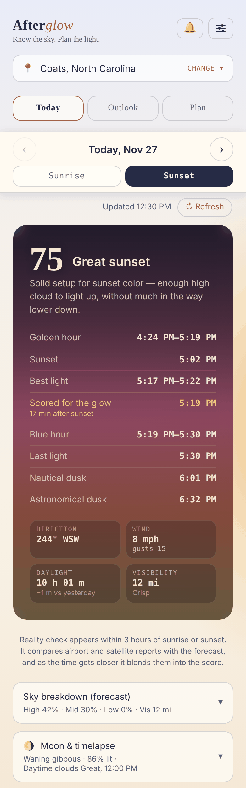
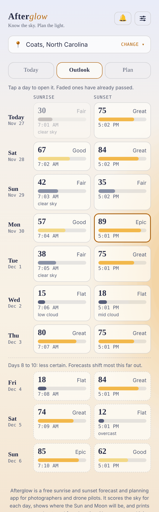
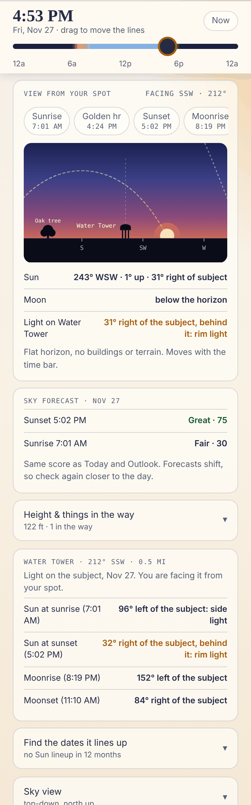

# Afterglow

**Sunrise and sunset sky-quality forecasts and shoot planning, built for photographers and drone pilots.**

🔗 [afterglow.johnstonaerial.com](https://afterglow.johnstonaerial.com)

📖 **[How to use Afterglow](HOW-TO.md)** — installing, notifications, the Plan tab and reading the score

Afterglow predicts how good a sunrise or sunset is actually going to look — not just whether the sun is up, but whether the sky will put on a show. Built for planning drone shoots, timelapses, and just knowing when to grab a camera.

☕ **Free to use.** If it helped you catch an epic shot — sunrise, sunset, or a moon timelapse — you can [buy me a coffee](https://buymeacoffee.com/JohnstonAerial).

## Screenshots

<table>
  <tr>
    <td align="center" width="33%"><picture><source media="(prefers-color-scheme: dark)" srcset="screenshots/01-today-dark.png"></picture> <b>Today</b></td>
    <td align="center" width="33%"><picture><source media="(prefers-color-scheme: dark)" srcset="screenshots/02-outlook-dark.png"></picture> <b>Outlook</b></td>
    <td align="center" width="33%"><picture><source media="(prefers-color-scheme: dark)" srcset="screenshots/03-plan-dark.png"></picture> <b>Plan</b></td>
  </tr>
</table>

Pictures use sample forecast numbers and the Coats, NC area. They follow your light or dark setting on GitHub.

## What's new

**2.5.14**
- **Today panel, rebuilt.** Every time now sits in one list, in the order the sky goes dark, and each one keeps its own row (golden hour, the event itself, blue hour, last light and so on). The full explanation is always shown, so there are no More or Less links to tap.
- **Four small tiles** under the list: Direction, Wind (with gusts), Daylight (length of the day and how many minutes it changed since yesterday) and Visibility, worded the same way as the Sky breakdown (Humidity if there is no visibility figure).
- **The page keeps your place on the top panel too.** The description changes length from day to day, so stepping through days used to make it jump. Now whatever you are reading stays put.
- **Settings button.** The header is now the title with the bell and one **Settings** button. Units (mi or km), Larger text, Theme, Help and Buy me a coffee are all inside it, so the top of the page is no longer a row of small buttons.

**2.5.13**
- **Day bar.** Under the tabs, one bar now holds the ‹ › day arrows, the date and the Sunrise | Sunset switch. It stays pinned to the top as you scroll, so you can change days while Sky breakdown or Moon is open. **Tap the date to jump back to today** (this replaces the "Back to today" button).
- **The page keeps your place** when you change the day or switch between Sunrise and Sunset: the section you are reading stays where it was, even when the panels above it change height.

**2.5.12**
- **Sky breakdown picture:** the low cloud layer is now drawn in a lighter shade with a faint lit edge, so a heavy low cloud deck is easy to see instead of blending into the dark sky.

**2.5.11**
- **Moonrise and moonset** on the Moon card now come from the same calendar day, with the next one first and past ones dimmed, so they agree with the Moon path curve (before, the moonset could be tomorrow's, which looked wrong after midnight).

**2.5.10**
- **Moon & timelapse header** keeps the emoji and title together on the left, with the summary on its own line, so a long summary no longer pushes the title across a wide window.

**2.5.9**
- **Moon path.** A small curve under Moonrise and Moonset shows the Moon's height across the day, with moonrise and moonset, sunrise and sunset lines, golden hour bands, night shading and a "right now" dot. It uses the Moon's position only, not the forecast.
- **Clearer Moon & timelapse header.** It now says **Daytime clouds** for the daytime timelapse, adds a **Moon:** note for the sky around the Moon, and drops "at noon" (the lit percentage is how much of the Moon the Sun lights, not whether it is visible).
- **Reopen refresh.** Reopening Afterglow after more than 15 minutes refreshes Today like the Refresh button, except on Plan, and keeps your place on the page.

**2.5.2**
- **Quicker first screen.** The forecast and score now appear as soon as the main forecast arrives. The reading toward the sun is added a moment later, and the score may shift a few points when it does.

**2.5.1**
- **New tagline and description.** Under the name it now reads "Know the sky. Plan the light." and Afterglow describes itself as a free sunrise and sunset forecast and planning app for photographers and drone pilots, in the page, the footer and link previews.

**2.5.0**
- **The score now moves toward what's actually happening.** Starting about 3 hours before sunrise or sunset, the forecast cloud layers are blended with what the satellite and nearby airports report right now, more and more as the time gets closer. Before that, it's the forecast alone. The Reality check card says so.
- **Timelapse window checked against live reports** within 3 hours of the event, so the best window can say when the sky isn't doing what the forecast promised.
- **Where the Moon is now.** On Today, the Moon card shows its direction and height right now, and its height at sunset when that differs.
- **Best timelapse window leaves out hours already gone** on today, and says plainly when there is no good window ("clear sky", "solid cloud" or "patchy cloud").
- **Dates on the cards.** The Moon & timelapse and Sky breakdown headers show the weekday and date when you're looking at a day other than today, and a moonset after midnight shows the weekday instead of "tomorrow".
- **Tighter "more cloud" warning** on the Reality check: scattered cloud or more against a forecast far lower now counts.
- **Faster start.** The forecast loads first; wind aloft and the second model fill in behind it, the map library loads only when Plan needs it, the location popup keeps its height while results load, and the app connects to the forecast and map servers earlier.
- **Evening tip** no longer says "Stay for the glow."

**2.4.7.6**
- **Scored for the glow.** The score now reads the forecast about 17 minutes after sunset (or before sunrise), when high cloud usually lights up, instead of the exact moment of the sun event. The tip under the score says which time it covers.
- **Reality check stays up longer.** The card now stays up for 17 minutes after the event, matching the glow window.

**2.4.7.5**
- **Reality check wording.** The airports used for the comparison are now marked "compared with forecast" instead of "used in the verdict".

**2.4.7.4**
- **Timelapse tip fixed.** It no longer overstates the hours of shooting for the best window, and it now gives an interval range by cloud speed (light, moderate or fast) instead of one exact number and a clip length.
- **Merged section title.** When the Sun and Moon windows match, the section is titled "Sun and Moon both up".

**2.4.7.3**
- **Best light in the times row.** A new item next to Sunrise or Sunset shows the 15 to 20 minute window when the color often peaks.
- **Wind at the event.** The times row shows the forecast surface wind at sunrise or sunset, with gusts when they add 5 mph or more, in your chosen units.
- **Clear-sky note.** On a clear sky the line under the score says clear skies top out around Fair and what could lift it.
- **Timelapse tidy-up.** When the Sun and Moon best windows are the same, the timelapse shows one section instead of two.

**2.4.7.2**
- **Sky breakdown note mentions the satellite.** It now says the Reality check compares the forecast with airport reports and the satellite.

**2.4.7.1**
- **Timelapse now works in daylight too.** The Moon & timelapse section scores the hours the Sun is up as well as the hours the Moon is up, so there is a best window most days.
- **Better cloud reading.** Low cloud now counts, so a solid low deck reads as overcast instead of clear, and wind no longer rescues a sky with no cloud at all.
- **A starting interval.** Each best window suggests a gap between frames from the wind aloft, and how long a clip the shoot would make.
- **Sky breakdown is labelled as forecast,** with a line saying the Reality check compares it with airport reports.

**2.4.7**
- **Clearer note on the Reality check.** The line at the bottom now says what the satellite and airports each can and can't see, and that the card is a cross-check that doesn't change the score.

**2.4.6**
- **Reality check stays up after sunset or sunrise.** The card now stays on Today for 17 minutes after the event, when the color is often at its best, and its header says how long ago it was ("Sunset 5 min ago").

**2.4.5**
- **Miles or kilometers.** A **mi / km** button at the top switches the whole app between miles and feet, and kilometers and meters. It starts from your device's region and remembers your choice. Cloud heights in airport reports stay in feet.
- **A smarter Reality check.** The card now compares the forecast with the airports out where the forecast is looking, lists every airport it used, and says plainly when those airports disagree with each other. The headline says which way they differ: airports showing more cloud than the forecast, or a forecast heavier than the airport reports. It also says when no airport is close enough to check, and it holds its height while loading so nothing jumps.
- **Satellite line.** The card also flags when the satellite sees much more or much less high cloud than the forecast.
- **Help** moved to the left of the header row, and a few distance readings that were stuck in kilometers now follow your choice.

**2.4.4**
- **Reality check.** In the last 3 hours before sunrise or sunset, a new card on Today compares the forecast with what is actually being reported toward the sun: recent airport weather reports (METARs) along the sun's direction, and a satellite line (NOAA GOES-19 cloud layers, a beta product) that can see high cloud, the layer that gives color. It says whether the airports agree with the forecast's low cloud. It appears only in that window and then goes away, and a small note on Today explains this when it is hidden. It does not change the score. It collapses and expands like the other cards.
- **Refresh button.** Today now shows when the forecast was last fetched and has a Refresh button that reloads it, keeping your day and sunrise or sunset choice.
- **Places in other time zones.** When you look at a place in another time zone (Los Angeles from the East Coast, for example), the sunrise and sunset direction, golden and blue hour, moon times, timelapse window and Reality check now use that place's own clock, and a note on Today says so. The app opens on the place's next sunrise or sunset.
- **Printing in light mode.** A dark band that could print across the top of the shoot card, when printed from the installed app, is gone. The light-mode status strip at the top of the installed app is gone too, so your phone's own status bar shows.

**2.4.3.3**
- **Easier to find in search.** A short plain-text description of Afterglow now sits at the bottom of the page, and the page tells search engines what it is. Nothing changes in how the app works.

**2.4.3.2**
- **Turn off counting of your own visits.** Tap the version text at the bottom five times to open a small box with a switch. It does the same as opening the page with `?notrack`, and it works in the app on your Home Screen too, where you cannot type an address.

**2.4.3.1**
- **Steadier loading.** The page now holds its height while the forecast loads, so the footer and the cards below no longer jump when the Today screen appears.

**2.4.3**
- **Three new Subject shapes.** Under "Looks like" you can now pick **City skyline**, **Mountain or ridge** or **Smokestack**, and the picture draws it on the horizon where your Subject is.
- **The Plan map keeps its view.** Changing "Looks like" (or anything else that redraws the page) no longer jumps the map back to your spot, so your spot and Subject stay in frame.
- **Long Subject names on the printed compass** are no longer cut off at the edge of the card.

**2.4.2**
- **Share links and the QR code carry more.** A link to a plan (and the QR code on the printed shoot card) now includes your Things in the way, the Subject's shape ("Looks like"), whether you're on the ground or in the air and how high, and the shoot window. When someone opens it, those things are added to that place on their device. Your notes and units are not included.
- **Saving a thing in the way tells you what's missing.** If a height or distance is blank, the Save form now marks the box and says so instead of doing nothing.
- **A new printed shoot card.** The compass shows each thing in the way as a shaded wedge, the Subject's distance is on it, and a small picture of the horizon at sunrise or sunset shows where the Sun or Moon will be. The QR code sits at the top right so it is always on page 1. Notes over 200 characters print on page 2.

**2.4.1**
- **View from your spot is the right size on a big screen.** On a Mac, iPad or other wide window the picture stops growing, so its text no longer gets huge.
- **Shorter Sun and Moon tags.** When the Sun or Moon is off the side of the picture, the tag now reads like "← Sun · 112° · 28° up". The arrow shows the side, and the rows under the picture give the full details. The tags also stay clear of the Subject label and of each other.

**2.4.0**
- **Drone Preflight Checklist button.** A blue button on **Today** (under Moon & timelapse) and on **Plan** (under the Sky forecast) opens the free Drone Preflight Checklist with the weather and airspace for your place already loaded. It says which place it will use. On Plan it uses the place you're planning from. The checklist's own **AfterGlow** button works the other way and opens Afterglow at the checklist's place, on Today.
- **A new look.** In dark mode, a soft gold glow along the right edge, like light at the horizon. In light mode, the page has a dawn-sky wash, from pale blue at the top through cream to a soft peach, with the same gold glow. The text, buttons and colors of the score card are unchanged.
- **View from your spot.** On the Plan tab, a new card under the time bar draws a flat horizon facing your Subject, with the Sun and Moon where they will be at the time on the bar. A dotted line shows each one's path. If the Sun or Moon is off the side or above the picture, a small tag says which way and how far. With no Subject pin, it faces the nearer of sunrise or sunset. The **Jump to** buttons (sunrise, golden hour, sunset, moonrise, moonset) sit at the top of the card as a row you can swipe sideways.
- **Draw what's in the way.** Trees, buildings, hills, towers and walls you add under Things in the way are drawn in the picture at their real direction and height, and the Sun or Moon row says when one is behind them. Pick a "Looks like" shape for your Subject (water tower, bridge, lighthouse, steeple, turbine and more) and it is drawn in the middle.
- **Type coordinates any way you have them.** Decimal degrees, degrees/minutes/seconds, survey style, compact aviation style (351230N 0783015W) or a pasted Google or Apple Maps link all work, in the Change location box and in Plan's search. In the US the place is named "Near <town>, ST".
- **Return works in Change location.** Press Go on the keyboard to pick the top result.
- **My location** is the same button, with a crosshair icon, on Today and Plan.
- **Plan page order.** View from your spot, Things in the way, the Subject card, Sky forecast, the checklist button, Find dates, then the top-down Sky view (closed) and Share, calendar & print. The forecast now sits close to the picture, so you can read it as you step from date to date.
- **Name this spot** moved up, to a row under the map-tap buttons, and appears once you've dropped a Subject pin.
- **The footer link** to the Drone Preflight Checklist now reads "Free Drone Preflight Checklist".

**2.1.1**
- **Outlook shows 10 days.** Days 8 to 10 have a dashed outline and a note that they are less certain, because forecasts shift most that far out. Today shows the same note on those days.
- **Outlook says why.** A Flat or Fair day gets a short reason underneath (low cloud, sun blocked, overcast, rain likely, hazy, clear sky).
- **Closed sections say more.** Sky breakdown, Moon & timelapse, Height & things in the way and Find dates now show a one-line summary in their header.
- **Close links.** Open sections have a **Close ▲** link at the bottom so you don't have to scroll back up.
- **Plan no longer lets you pick days in the past**, and the date row fits small screens with Larger text on.
- Today's date line, the Things in the way form and a few long messages were tightened so nothing is cut off on narrow phones.

**2.1.0**
- **Light mode.** A new button in the header opens a **Theme** menu with **Auto**, **Light** and **Dark**. Auto follows your device setting and is the default. The big sky card stays dark on purpose in light mode.
- The **ⓘ About** button is now a small **?** that opens this README.
- The map's locate button (full screen) now frames your spot and your subject together above the bottom panel.
- The calendar before/after box is no longer cut off, and a few smaller light-mode touches (coffee cup, card tint, round date arrows).

**2.0.4**
- **Full screen map.** On the Plan tab, tap **⤢** on the map to fill the whole screen. A panel along the bottom has the time slider, **Now**, quick jumps (sunrise, golden hour, sunset, moonrise) and a **Subject / Your spot** switch, so you can watch the Sun and Moon lines move across the map. Tap **✕** (or press Esc) to close it, and the small map re-fits so your spot and your subject are both in view.

**2.0.3**
- A tagline under the name ("Plan your shoot around the sky"), and the version number moved to the bottom of the page.
- A link to the free Drone Preflight Checklist ("Also from Johnston Aerial") in the footer.
- A new preview image and description when you share a link to Afterglow.
- The Sky breakdown and Moon & timelapse cards wrap cleanly on small screens and with larger text.

**2.0.2**
- On the Plan map, the **⌖** button now returns to the place you were planning from before you dropped a pin (for example My location), instead of your saved place.

**2.0.1**
- One place control, in the same spot on every tab.
- The bell window shows which place your alerts are for.
- Clearer saved-place wording, and install steps added to the how-to guide.

## What's new in 2.0

Afterglow 2.0 is a big redesign of the Plan tab, with a few new tools.

- **Plan tab, rebuilt.** A time bar that stays at the top, a clear "Planning from" place, a **Subject** and **Your spot** you place on the map, a sky view, and less clutter. Rarely used tools are folded away until you need them.
- **Calendar, your way.** Add a shoot to your calendar at sunrise or sunset, or choose **Custom**: start 2 hours before sunset, 30 minutes before moonrise, at a clock time, or at the time on the bar, for as long as you like.
- **Alerts with a minimum forecast.** Sunrise and sunset alerts can wait until the forecast is Good, Great or Epic, and tell you the score. Poor skies stay quiet.
- **My location**, everywhere. One button in the place pickers, and your saved place only changes when you tap it.
- **Larger text** with the **Aa** button.
- **Easier Today and Outlook.** Day arrows on Today, past times dimmed on Outlook, and tap a day to open it.
- **Kinder to computers.** Scrolling over the map scrolls the page. Zoom with +/−, or ⌘/Ctrl + scroll.
- **Fixes.** Location works on Chrome for Mac, and the Plan sky forecast no longer gets stuck on "Reading the sky…".

## Features

- **Sky quality scoring** — a heuristic model based on published sunset-photography guidance: mid/high cloud in the right range catches color, low cloud blocks it, haze flattens it. Scores are checked against real shoots and still being refined. Like any forecast, it can miss, especially on high cloud.
- **Golden & blue hour, precisely** — computed from actual solar angle (civil twilight math), not flat clock-time offsets. Nautical and astronomical twilight times shown when they fall that day.
- **Outlook** — the coming sunrises and sunsets, each scored, with past times dimmed.
- **Any location** — search by city, state or ZIP, type coordinates, or use your current position, and switch any time with the location button. Your chosen location stays on your device.
- **Moon conditions** — phase, illumination, moonrise/moonset with compass headings, and a callout for the "big warm moon on the horizon" alignment window. Includes an hourly timelapse-conditions score.
- **Plan tab** — Sun and Moon direction and height at any time, on any date, anywhere, on a free, keyless Leaflet/OpenStreetMap map that also opens full screen. Place a subject, find the dates the Sun or Moon lines up with it, allow for height and obstructions, share a link, add the shoot to your calendar, or print a shoot card.
- **Reality check** — in the 3 hours before sunrise or sunset, a card compares the forecast with recent airport weather reports toward the sun and a satellite view of high cloud. It appears only in that window, and in that window the score moves toward what they report (see 2.5.0 in What's new).
- **Three tabs** — Today, Outlook and Plan.
- **Installable app (PWA)** — add it to your Home Screen on iOS or Android for a real standalone app experience, with offline support for the app itself (forecast data always pulls fresh, never stale).
- **Push notifications** — optional alerts before sunrise, sunset, or golden hour (morning and evening), sent right to your phone. You choose which alerts you want and how far ahead: 15, 30, 60 or 90 minutes, and sunrise and sunset alerts can wait for a minimum forecast (Good or better, Great or better, or Epic only). Notifications need the app installed (Home Screen on a phone or tablet, Dock or app window on a computer) (see the [how-to](HOW-TO.md)).
- **Built-in resilience** — automatic retry with backoff, cached last-known data with a clear "stale" indicator, and plain-language error messages instead of raw failures.

## How it works

- New to Afterglow? The [how-to guide](HOW-TO.md) covers installing, notifications and reading the score.

- Forecast data comes from [Open-Meteo](https://open-meteo.com/) — free, no API key required.
- Moon phase, moonrise and moonset are calculated on your device with [Astronomy Engine](https://github.com/cosinekitty/astronomy) (MIT licence, by Don Cross). Nothing about your location is sent anywhere for this, and it works offline. Checked against the US Naval Observatory, rise and set times agree to within a minute.
- Cloud cover is sampled along the sun's actual azimuth (not just overhead) using great-circle geometry, to judge whether direct light can actually reach the horizon.
- The Reality check gets airport reports from NOAA's Aviation Weather Center through a small Cloudflare Worker, and satellite cloud layers from NOAA's GOES-19 satellite, boiled down to a small grid by a GitHub Action every 15 minutes (the `sat-data` branch of this repo). Airport reports see cloud below about 12,000 ft; the satellite can see high cloud but shows the sky now, not at sunrise or sunset, and NOAA labels the product beta.
- Notifications run on a Cloudflare Worker with a scheduled check every 5 minutes, using Web Push — no app store, no third-party notification service.

## Good to know

- Weather models update a few times a day, so a forecast can change when a new run arrives. Check again closer to the time, especially for sunsets more than a day out.
- Color often peaks a little after sunset (15–20 minutes) or just before sunrise, so Afterglow shows that window on the main card for Fair and better days.
- Scores run from Flat to Fair, Good, Great and Epic. Treat them as a guide to the odds, not a promise.

## Tech

Single-file HTML/CSS/JS front end, no build step. Notification backend is a standalone Cloudflare Worker (`worker.js`) using only the Web Crypto API — no external push libraries. Visits are counted with [Cloudflare Web Analytics](https://www.cloudflare.com/web-analytics/).

## Status

Actively used and evolving. Scoring constants (cloud sweet-spot ranges, murk-penalty thresholds, sampling distance) are being refined against real shoot outcomes over time.

## Privacy

Afterglow has no accounts and no ads. Your chosen location stays on your device, except when you turn on notifications: then that location, your alert choices and your phone's push address are stored so the alerts can be sent, and they're removed when you turn notifications off. The page also uses Cloudflare Web Analytics, a privacy-focused visit counter. It counts visits and rough details like country and device type, with no cookies and no personal information, so I can see whether Afterglow is being used. While the Reality check is showing, a few points along the sun's direction (rounded to about 1 km) are sent to a small Cloudflare Worker that passes them to NOAA's Aviation Weather Center to look up nearby airport reports; they are not stored.

## Support this project

Afterglow is free. If it's saved you time, or helped you catch an epic sunset, sunrise, or moon shot you'd have otherwise missed, you can [buy me a coffee ☕](https://buymeacoffee.com/JohnstonAerial). It helps cover the time I put into keeping it accurate.

Thank you, and good light.
— Jim, Johnston Aerial
---

Built by [Johnston Aerial](https://johnstonaerial.com).
